# Uptick Coding

A web crawling and lead-scoring pipeline for finding high-fit B2B service companies. Uptick takes a list of company domains, crawls the most relevant pages, extracts evidence, enriches each company profile, and scores fit for outbound or RevOps workflows.

## Why I Built Uptick

Most lead lists are shallow. A spreadsheet can tell you a company name, domain, industry, and maybe a generic category, but it rarely tells you whether the company actually matches a specific sales motion.

Uptick was built to answer the more useful question: based on the company website itself, does this account look like the kind of business worth prioritizing? The system crawls targeted pages, extracts service evidence, classifies what the company does, and applies a scoring layer that can be tuned to a real ICP.

## Quick Start

Install Python dependencies:

```bash
python -m venv venv
source venv/bin/activate
pip install -r requirements.txt
```

Deploy the crawler to Modal:

```bash
modal deploy crawler/modal_deploy_real.py
```

Run a small crawl:

```bash
modal run crawler/modal_deploy_real.py --total-domains 30
```

Run the batch orchestrator:

```bash
./run_batch_crawler.sh --next
```

## Philosophy

Evidence before scoring. The score should be traceable back to pages, snippets, service language, and structured extraction output.

Targeted crawling beats blind crawling. Uptick prioritizes pages that are likely to reveal service fit, not every page a site exposes.

Batchable by design. The pipeline is meant to process thousands of domains in repeatable chunks, not just a local one-off scrape.

Human-tunable scoring. The scoring layer uses explicit config and prompts so the ICP can change without rewriting the crawler.

## What It Supports

Targeted domain crawling - crawl company sites with page selection and extraction logic optimized for service classification.

Modal batch execution - run crawls in cloud containers with progress tracking and resumable batches.

CSV-driven input - process HubSpot/export-style domain lists with configurable domain and record ID columns.

Evidence extraction - produce JSONL outputs with crawled text, extracted service evidence, and metadata.

LLM scoring - classify service fit using prompt templates and scoring models.

Numerical scoring - apply deterministic caps and score rules through YAML configuration.

Result analysis - inspect and rescore sample outputs during ICP tuning.

## Architecture

```mermaid
flowchart LR
  CSV["Input CSV"] --> Batch["Batch runner"]
  Batch --> Modal["Modal crawler job"]
  Modal --> Crawler["Targeted crawler"]
  Crawler --> Pages["Selected website pages"]
  Pages --> Evidence["Extracted evidence JSONL"]
  Evidence --> LLM["LLM classification"]
  LLM --> Score["Numerical scoring layer"]
  Score --> Output["Scored account list"]
```



The crawler runs on Modal for scalable execution. `run_batch_crawler.sh` controls batch offsets and progress. `crawler/modal_deploy_real.py` mounts the input CSV and crawler code into Modal, then invokes the crawler with the right `from_index` and batch size. Scoring is separated into the `scoring/` package so classification, scoring prompts, and deterministic numerical rules can evolve independently.

## Stack

- Python 3.11+
- Modal for cloud execution
- JSONL for crawl and scoring artifacts
- YAML scoring configuration
- LLM prompt templates for service classification
- Shell scripts for batch orchestration

## Key Files

- `crawler/modal_deploy_real.py` - Modal deployment and crawler entrypoint
- `crawler/run_crawl.py` - targeted crawl execution
- `crawler/config.json` - CSV and crawler configuration
- `run_batch_crawler.sh` - batch runner with progress tracking
- `scoring/` - scoring models, CLI, API, config, and numerical scoring
- `scoring/numerical_scoring_config.yaml` - deterministic scoring rules and caps
- `scoring_prompt_template.md` - prompt template for scoring/classification
- `5.-Docs/` - crawler and scoring documentation
- `3-tasks/` - PRDs, research notes, and implementation task plans

## Health Checks

Run the crawler test suite:

```bash
pytest crawler/tests
```

Run scoring locally on a sample output:

```bash
python rescore_sample.py
```

## Repository Notes

Runtime crawl outputs, Modal progress logs, Python bytecode, local environment files, and local cache directories should stay out of git. Commit durable code, configs, docs, and small intentional samples only.
